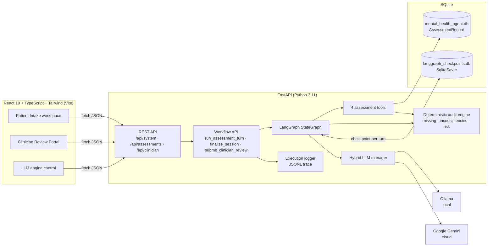
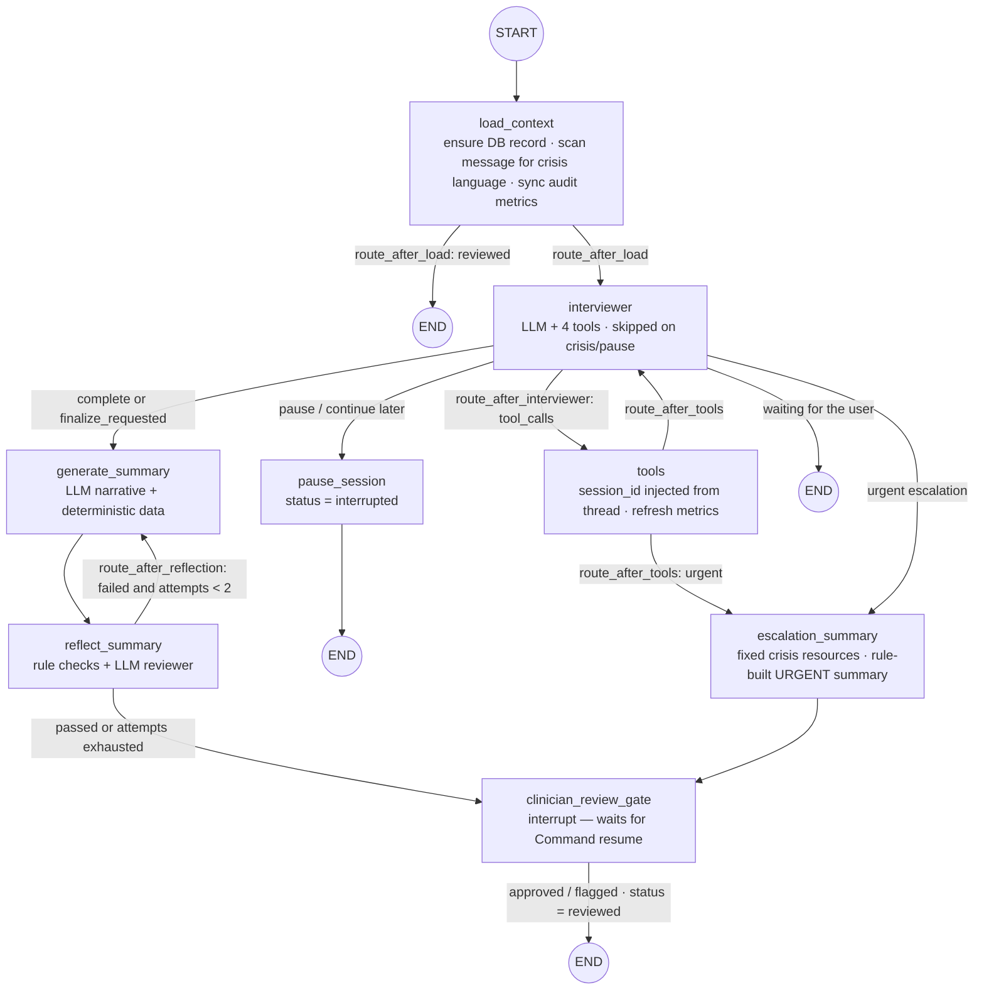

# MindBridge Intake AI

**Intelligent Mental Health Screening and Initial Assessment Agent using LangGraph** (midterm project)

A conversational intake agent that gathers self-reported information across six clinical domains,
audits it for gaps, contradictions and risk, writes a structured non-diagnostic summary, checks that
summary against the stored record (reflection), and pauses for a clinician to approve it
(human-in-the-loop). It runs on a local Ollama model or Google Gemini.

> **Not a diagnostic tool.** The agent organises what a person reports for a qualified professional.
> It never diagnoses or recommends treatment, and safety-critical disclosures are escalated with
> fixed crisis resources that don't depend on an LLM.

---

## Quick Start (one-command launch)

Prerequisites: **Python 3.11+** and **Node.js 20+**. Everything else is set up on the first run.

| | Start | Stop |
|---|---|---|
| Linux / macOS | `./start.sh` | `./stop.sh` |
| Windows (Command Prompt) | `start.bat` | `stop.bat` |

On the first run the start script:
1. creates `backend/.venv` and installs `backend/requirements.txt` (and reinstalls automatically whenever that file changes);
2. runs `npm install` in `frontend/` if `node_modules` is missing;
3. copies `backend/.env.example` to `backend/.env` if it doesn't exist;
4. picks free ports, starts FastAPI and Vite, waits for `/api/system/health`, and prints the URLs.

**Port conflicts are handled automatically.** If `8000` (API) or `5173` (UI) is already used by another
app, the backend moves to `8010` and the frontend to `5174` (or the next free port), and the matching
`CORS_ORIGINS` / `VITE_API_BASE_URL` are set for you. Other apps are never stopped or taken over.
To choose ports yourself: `BACKEND_PORT=9000 FRONTEND_PORT=3000 ./start.sh` (Windows: `set BACKEND_PORT=9000` first).

**Add an LLM:** put your key in `backend/.env`, then restart:

```
GEMINI_API_KEY=your-key-from-aistudio.google.com
```

or leave `LLM_PROVIDER=auto` with a working local Ollama (see [Hybrid LLM configuration](#hybrid-llm-configuration)).

Where things go:
- **Linux/macOS:** PIDs and logs are in `.run/` (`backend.log`, `frontend.log`). `stop.sh` stops only this
  project's processes: the recorded PIDs, their children, and any uvicorn/vite started from this folder.
- **Windows:** each server runs in its own window (`MindBridge-Backend`, `MindBridge-Frontend`). `stop.bat`
  closes those windows and any leftover uvicorn/vite process whose command line points into this folder.

---

## Contents

0. [Quick Start](#quick-start-one-command-launch)
1. [Architecture](#architecture)
2. [LangGraph state graph](#langgraph-state-graph)
3. [Repository layout](#repository-layout)
4. [Setup](#setup)
5. [Hybrid LLM configuration](#hybrid-llm-configuration)
6. [Running the app](#running-the-app)
7. [Tests and the 5 exam scenarios](#tests-and-the-5-exam-scenarios)
8. [Requirement mapping](#requirement-mapping)
9. [API reference](#api-reference)
10. [Safety design and limitations](#safety-design-and-limitations)

---

## Architecture



| Layer | Key files |
|---|---|
| Hybrid LLM manager | `backend/app/core/llm_manager.py`, `config.py` |
| Persistence | `backend/app/db/database.py`, `models.py`, `checkpointer.py` |
| Schemas (6 domains, summary) | `backend/app/schemas/assessment.py` |
| Audit engine | `backend/app/services/assessment_audit.py` |
| Tools | `backend/app/tools/assessment_tools.py` |
| Graph | `backend/app/graph/{state,prompts,nodes,workflow}.py` |
| API | `backend/app/main.py`, `backend/app/api/routes/{system,assessments,clinician}.py` |
| Execution trace | `backend/app/core/execution_logger.py` |
| Exam scenarios | `backend/app/evaluation/`, `backend/scripts/run_exam_scenarios.py` |
| Frontend | `frontend/src/{api,types,components}/` |

## LangGraph state graph



- **State** (`AssessmentGraphState`): `messages` (with the `add_messages` reducer), `session_id`, `patient_alias`,
  `llm_provider`, `completion_pct`, `missing_fields`, `inconsistencies`, `risk_flags`,
  `requires_urgent_escalation`, `assessment_complete`, `draft_summary`, `reflection_passed`,
  `reflection_feedback`, `reflection_attempts`, `clinician_reviewed`, `clinician_notes`, `final_output`,
  plus `finalize_requested` and `message_risk_flags`.
- **Memory:** one checkpointer thread per session (`thread_id == session_id == AssessmentRecord.session_id`),
  stored by `SqliteSaver` in `data/langgraph_checkpoints.db`. Conversations survive server restarts.
- **Tools:** `store_assessment_response`, `retrieve_assessment_record`, `validate_and_audit_responses`,
  `get_screening_questionnaire_guide`. `session_id` is an `InjectedToolArg`: the model never sees it,
  and the graph always supplies the thread's ID, so one session can't write to another.

## Repository layout

```
backend/
  app/
    core/         config, hybrid LLM manager, execution logger, exceptions
    db/           SQLAlchemy engine, AssessmentRecord, SqliteSaver checkpointer, repository
    schemas/      6 domain models, AssessmentSummaryOutput, API models
    services/     deterministic audit engine, list/queue views
    tools/        the 4 LangChain tools
    questionnaires/  PHQ-2 / GAD-2 / WHO-5 inspired question guides
    graph/        state, prompts, nodes, workflow (+ session API)
    api/          FastAPI routers and dependencies
    evaluation/   5 exam scenarios, scripted model, runner, Markdown report
  scripts/        run_exam_scenarios.py, setup_ollama.py
  tests/          86 tests (pytest)
  logs/           exam_execution_report.md, exam_execution_trace.jsonl
frontend/
  src/api/client.ts      typed API client
  src/types/api.ts       TypeScript mirrors of the Pydantic schemas
  src/components/        TopBar, PatientWorkspace, ClinicianWorkspace, SummaryView, …
```

## Setup

The start scripts above do all of this for you. Manual setup:

Requirements: **Python 3.11+**, **Node 20+**. Ollama is optional; it can be installed automatically.

```bash
cd backend
python3.11 -m venv .venv
source .venv/bin/activate
pip install -r requirements.txt   # includes pytest and ruff
cp .env.example .env          # then edit .env (see below)
```

```bash
cd frontend
npm install
cp .env.example .env          # VITE_API_BASE_URL=http://localhost:8000
```

## Hybrid LLM configuration

Set in `backend/.env`:

| Variable | Default | Meaning |
|---|---|---|
| `LLM_PROVIDER` | `auto` | `auto` = local Ollama if it's ready within `OLLAMA_AUTO_FALLBACK_TIMEOUT`, else Gemini · `local` · `gemini` |
| `GEMINI_API_KEY` | — | Google AI Studio key (https://aistudio.google.com/apikey) |
| `GEMINI_MODEL` | `gemini-flash-lite-latest` | Auto-updating alias (pinned versions get retired). `gemini-3.8-flash` is stronger but often overloaded |
| `GEMINI_TIMEOUT` / `GEMINI_MAX_RETRIES` | `60` / `2` | Fail fast with a clear error when the model is busy |
| `OLLAMA_BASE_URL` | `http://localhost:11434` | |
| `DEFAULT_LOCAL_MODEL` | `qwen2.5:7b` | Must support tool calling (e.g. `qwen2.5:7b`, `llama3.1:8b`, `llama3.2`) |
| `OLLAMA_AUTO_INSTALL` / `OLLAMA_AUTO_PULL` | `true` | Install Ollama / pull the model when missing |
| `EXECUTION_LOG_ENABLED` / `EXECUTION_LOG_PATH` | `true` / `logs/execution_trace.jsonl` | JSONL trace of every graph run |
| `LANGCHAIN_TRACING_V2` / `LANGCHAIN_API_KEY` | — | LangSmith tracing (enabled only when a key is set) |

On startup, with `auto` or `local`, the backend checks Ollama **in the background**. It looks for the
binary and installs it if missing, starts `ollama serve`, pulls the model, and test-loads it. The API is
available immediately; progress is shown at `GET /api/system/status` and in the UI's engine pill.
The provider and model can be switched at runtime from the UI or with `POST /api/system/llm/configure`.

Check the engine from the command line:

```bash
cd backend && .venv/bin/python -m app.core.llm_manager --provider gemini   # or --provider local --model llama3.2
```

## Running the app

```bash
cd backend && .venv/bin/uvicorn app.main:app --reload --port 8000     # API docs: http://localhost:8000/docs
```

```bash
cd frontend && npm run dev                                             # http://localhost:5173
```

**Port already in use?** Run both on other ports and tell each about the other (no code changes):

```bash
cd backend && CORS_ORIGINS=http://localhost:5174 .venv/bin/uvicorn app.main:app --reload --port 8010
```

```bash
cd frontend && VITE_API_BASE_URL=http://localhost:8010 npm run dev -- --port 5174
```

## Tests and the 5 exam scenarios

```bash
cd backend && .venv/bin/python -m pytest -q          # 84 passed, 2 skipped (live LLM tests are opt-in)
```

| Test module | Covers |
|---|---|
| `test_tools.py` | 4 tools, audit engine (missing / conflicts / distress), crisis lexicon incl. denials |
| `test_graph.py` | multi-turn memory across restarts, session-id injection, escalation, reflection loop, HITL interrupt, pause/resume |
| `test_api.py` | every REST endpoint, error envelopes, CORS, queue priority, clinician review |
| `test_exam_scenarios.py` | the 5 required scenarios end-to-end, JSONL trace, Markdown report, UI seeding |

### Exam scenario runner

```bash
cd backend && .venv/bin/python -m scripts.run_exam_scenarios           # deterministic, offline (CI / grading)
cd backend && .venv/bin/python -m scripts.run_exam_scenarios --live    # same patient messages, real Gemini/Ollama
cd backend && .venv/bin/python -m scripts.run_exam_scenarios --seed-ui # load the 5 cases into the dev DB for the UI demo
```

Outputs:
- `backend/logs/exam_execution_report.md`: for every scenario, the verification checks, the conversation,
  a step-by-step trace (nodes, tool calls with arguments and results, routing decisions, reflection
  verdicts, interrupts) and the **5 expected outputs**.
- `backend/logs/exam_execution_trace.jsonl`: the same trace as one JSON event per line.

| # | Scenario | What is verified | Final state |
|---|---|---|---|
| 1 | Complete assessment | 18/18 fields over 6 turns, reflection passes, summary → `awaiting_clinician_review` → clinician approval | `reviewed`, 100% |
| 2 | Missing responses | early submission; completion 50%; all 9 omitted fields listed as `[M1]`–`[M9]` | `awaiting_clinician_review` |
| 3 | Conflicting responses | "0/10 stress, completely fine" vs panic attacks most days, 2 h sleep, unable to work → 3 `[I#]` contradictions | `awaiting_clinician_review` |
| 4 | Significant distress | disclosure caught **before** the LLM, crisis resources shown, `requires_urgent_escalation`, `[R1] URGENT`, first in queue | `awaiting_clinician_review` (urgent) |
| 5 | Interrupted | pause → `interrupted`; a **separate OS process** reads the same checkpoint; resume on the same `session_id` continues | `in_progress`, 50% |

`--seed-ui` leaves the cases at demo-friendly stages: 1 `reviewed`, 4 urgent, 3 inconsistent,
2 partial, 5 `interrupted` and ready to resume. Re-running it replaces the demo cases rather than
duplicating them. Resuming case 5 in the UI needs a working LLM.

## Requirement mapping

### Functional

| Requirement | How it is met |
|---|---|
| Mood & emotional wellbeing (PHQ-2-style) | `MoodDomain`: PHQ-2 items (0–3), mood rating, hopelessness, self-harm thoughts, WHO-5 items |
| Stress (1–10 + triggers) | `StressDomain`: 0–10 level (so "0/10" can be recorded), triggers, duration, coping |
| Sleep (hours, quality, insomnia/hypersomnia) | `SleepDomain`: hours, quality, 6 insomnia/hypersomnia indicators |
| Anxiety (GAD-2-style, physical/cognitive) | `AnxietyDomain`: GAD-2 items, panic attacks, physical and cognitive symptoms, avoidance |
| Daily functioning | `FunctioningDomain`: work/study impact, social engagement, energy, self-care, days missed |
| Personal concerns & goals | `ConcernsDomain`: narrative, challenges, support goals |
| Structured, empathetic questioning | `get_screening_questionnaire_guide` + interviewer prompt (1–2 questions at a time, trauma-informed) |
| Missing / inconsistent information | `assessment_audit.missing_fields` and 7 contradiction rules → `[M#]` / `[I#]` |
| Flag severe distress for professional review | structured + free-text risk rules → `[R#]`; critical cases escalate immediately |
| Summary of reported concerns | `AssessmentSummaryOutput.reported_concerns_summary` |
| Completion status | `completion_status` + `domain_completion_map` (per-domain progress in the UI) |

### Technical

| Requirement | How it is met |
|---|---|
| LangGraph agent with state | `StateGraph(AssessmentGraphState)`, 8 nodes, 4 conditional routers |
| Tool use | 4 `@tool`s with Pydantic `args_schema`; injected `session_id` |
| Memory / persistence | `SqliteSaver` checkpoints + SQLAlchemy `AssessmentRecord`; survives restarts (scenario 5) |
| Reflection / self-correction | `reflect_summary`: rule checks (diagnostic language, every `[M#]`/`[I#]`/`[R#]` covered) + LLM reviewer; up to 2 regenerations |
| Human-in-the-loop | `interrupt()` in `clinician_review_gate`, resumed with `Command(resume=…)` via `POST /api/clinician/{id}/review` |
| Local + cloud LLM | Ollama auto-detect/install/pull/load + Gemini, `auto` fallback, runtime switching |
| API + UI | FastAPI (10 endpoints, OpenAPI tags, JSON error envelopes) + React/TypeScript/Tailwind |
| Observability | JSONL execution trace of every graph run; LangSmith when configured |

### Testing (exam)

| Requirement | Evidence |
|---|---|
| 5 synthetic scenarios | `app/evaluation/scenarios.py`, `tests/test_exam_scenarios.py` |
| 5 expected outputs per scenario | `runner.expected_outputs` → report section "Expected outputs" 1–5 |
| Execution logs | `logs/exam_execution_report.md`, `logs/exam_execution_trace.jsonl` |

### Ethical / non-diagnostic

| Requirement | How it is met |
|---|---|
| Never diagnose or prescribe | prompt boundaries + reflection blocks diagnostic and treatment language; the clinician sees any warning |
| Mandatory disclaimer | `non_diagnostic_disclaimer` is always overwritten with the reviewed wording, even if the LLM or a clinician edits it |
| Crisis safety | every user message is screened before the LLM; fixed crisis resources (988, Samaritans, emergency numbers, findahelpline.com) |
| Professional oversight | every summary waits for clinician sign-off; urgent cases are sorted to the top of the queue |
| Privacy | anonymised aliases only (UI asks for "never a real name"); data stays in local SQLite; local LLM option |

## API reference

| Method | Path | Purpose |
|---|---|---|
| GET | `/api/system/health` | liveness |
| GET | `/api/system/status` | LLM engine, Ollama setup progress, tracing |
| POST | `/api/system/llm/configure` | switch provider/model, re-check local engine |
| POST | `/api/assessments/start` | new session with greeting |
| POST | `/api/assessments/{id}/message` | one patient turn |
| POST | `/api/assessments/{id}/finalize` | submit early for review |
| GET | `/api/assessments/{id}` | full state, history, domain data, summary |
| GET | `/api/assessments` | session list (status filter, paging) |
| GET | `/api/clinician/queue` | awaiting review (urgent first) + recently reviewed |
| POST | `/api/clinician/{id}/review` | approve or flag, optional edited summary; resumes the graph |

Errors always have the shape `{"error": {"code", "message", "details"}}`.

## Safety design and limitations

- **Deterministic where it matters:** crisis detection, escalation text, pause handling, the audit rules
  and the disclaimer don't depend on an LLM. Only the interviewer's wording and the narrative summary are generated.
- **Crisis lexicon:** any self-harm or harm-to-others phrase escalates unless it is a narrow, explicit denial
  ("no thoughts of hurting myself", "I would never hurt myself"). Ambiguous phrasing ("I haven't stopped thinking
  about suicide", "I don't want to wake up") always escalates. Keyword rules can't catch every phrasing,
  which is why every case still goes to a clinician.
- **Scripted vs live:** the graded scenario run replaces only the LLM with a script, so it's
  reproducible. `--live` uses the same patient messages with the real model; results then depend on the model.
- This is an academic prototype, not a medical device. It has not been clinically validated.
# MidTermPaper
