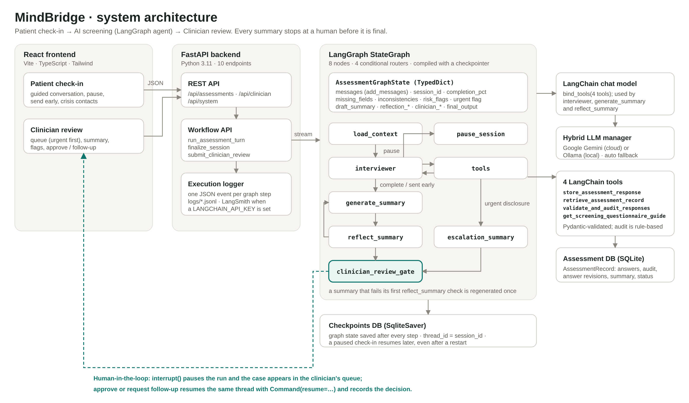
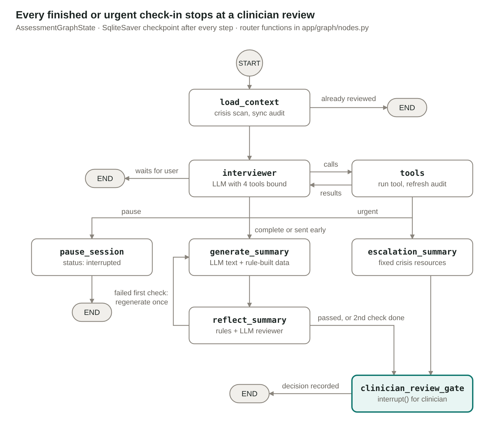

# MindBridge Intake AI — Technical Report

Development of an Intelligent Mental Health Screening and Initial Assessment Agent Using LangGraph

**Author:** Azhar Hussain · **Date:** 13 November 2026 · Examination 1 – Mental Health Screening and Initial Assessment Agent

## 1. Abstract and introduction

MindBridge Intake AI is a LangGraph agent that runs a structured mental health intake conversation, organises the answers into six domains and hands a checked, non-diagnostic summary to a clinician for sign-off. Across five synthetic test scenarios it passed 34 of 34 automated checks with a scripted model, and 33 to 34 of 34 in live runs with Gemini.

Mental health professionals usually collect the same background before a first consultation: mood, stress, sleep, anxiety, daily functioning and the person's own concerns. Gathering this by hand is slow, and answers are often incomplete or contradictory. The aim of this project is an agent that collects that information conversationally, stores it in a structured form, finds what is missing or inconsistent, flags answers that need professional attention, and produces a summary a clinician can review.

The system is deliberately limited in scope. It organises self-reported information only: it never names a condition, interprets a score as a diagnosis or recommends treatment. Every summary waits for a qualified clinician, and any disclosure of risk is escalated with fixed crisis resources rather than left to the language model.

## 2. Requirements and design goals

Every functional and technical requirement in the brief maps to a specific part of the implementation.

| Requirement | How it is met |
|----|----|
| Interactive assessment workflow | Multi-turn chat driven by the interviewer node; one or two questions at a time |
| Six information areas | Pydantic schemas MoodDomain, StressDomain, SleepDomain, AnxietyDomain, FunctioningDomain, ConcernsDomain |
| Established questionnaires | PHQ-2, GAD-2 and WHO-5 style items, served by the get_screening_questionnaire_guide tool |
| Store, retrieve, validate, find missing/inconsistent | Tools store_assessment_response, retrieve_assessment_record, validate_and_audit_responses |
| Structured summary | AssessmentSummaryOutput with the five expected outputs |
| Conditional routing | Four router functions: incomplete, paused, urgent and complete paths |
| Human-in-the-loop | interrupt() in clinician_review_gate, resumed by the clinician's decision |
| LangChain + StateGraph + state schema | StateGraph(AssessmentGraphState) with 8 nodes; LangChain chat models with tool calling |
| Memory / checkpointing | SqliteSaver checkpoint per session plus a SQLite assessment record |
| Reflection step | reflect_summary: rule checks and an LLM reviewer; a failed summary is regenerated once |
| Execution logs | JSONL trace of every graph step; LangSmith tracing when a key is set |

Three design goals shaped the implementation beyond the brief:

- **Deterministic where safety matters.** Crisis detection, escalation text, missing-field and contradiction rules, and the disclaimer never depend on the language model.

- **The model only talks and writes prose.** Structured data is validated by schemas, so a model error cannot corrupt the record.

- **Resumable by design.** Each session is one checkpoint thread, so a conversation survives a pause, a browser refresh or a server restart.

## 3. System architecture

The system has three layers: a React frontend, a FastAPI backend built around one LangGraph StateGraph, and local SQLite storage, with the language model behind a swappable manager.

A patient message travels from the browser through the REST API and the workflow layer into the graph. The graph calls the model through the LLM manager, the tools write validated answers to the assessment database, and the checkpointer saves the graph state after every turn. The clinician portal reads the same records and resumes the paused graph with its decision.

## 4. LangGraph design

The agent is one StateGraph(AssessmentGraphState) with 8 nodes and 4 conditional routers; each session is a checkpoint thread, so every turn resumes exactly where the last one stopped.

The four routers decide every branch: route_after_load ends a session that is already reviewed; route_after_interviewer sends tool calls to tools, an urgent disclosure to escalation_summary, a pause to pause_session, a complete or early-submitted intake to generate_summary, and otherwise waits for the patient; route_after_tools escalates if a stored answer is critical; route_after_reflection regenerates a summary that fails its first check, once.

**State schema.** AssessmentGraphState is a TypedDict; messages uses LangGraph's add_messages reducer so turns append rather than overwrite.

| Group | Fields |
|----|----|
| Conversation | messages, session_id, patient_alias, llm_provider |
| Progress and audit | completion_pct, missing_fields, inconsistencies, risk_flags, message_risk_flags, assessment_complete, finalize_requested |
| Safety | requires_urgent_escalation |
| Summary and reflection | draft_summary, reflection_passed, reflection_feedback, reflection_attempts |
| Clinician review | clinician_reviewed, clinician_notes, final_output |

**Memory and checkpointing.** The graph is compiled with a SqliteSaver; the thread id equals the session id. After a pause, a browser refresh or a server restart, the next message loads the saved state and the interview continues. Resending a message that never got a reply (for example after a model timeout) re-runs that turn instead of adding a duplicate. The clinician gate uses the same mechanism: interrupt() saves the state and stops, and Command(resume=…) continues it later.

## 5. Tools and the deterministic audit engine

The agent has four LangChain tools, each defined with @tool and a Pydantic args_schema; the brief asks for at least two.

| Tool | Purpose | Key behaviour |
|----|----|----|
| store_assessment_response | Save answers for one domain | Validates against the domain schema; on error returns field-level messages so the model can correct itself; merges into the SQLite record and returns completion % |
| retrieve_assessment_record | Load the current and earlier assessments | Returns the session's record plus history for the same anonymous alias, for resuming and continuity |
| validate_and_audit_responses | Check the whole record | Returns missing required fields, contradictions and risk flags, and whether escalation is needed |
| get_screening_questionnaire_guide | Supply structured questions | PHQ-2, GAD-2 and WHO-5 style items per domain, each naming the field it fills |

The session_id argument is injected by the graph (InjectedToolArg) rather than chosen by the model, so one conversation can never write to another session's record.

**Audit engine.** The checks behind validate_and_audit_responses are plain Python rules in assessment_audit.py, not model judgements, so they give the same answer every time:

- **Missing information:** 18 required fields across the six domains; anything unanswered is listed and later tagged \[M1\], \[M2\]…

- **Inconsistencies:** 7 contradiction rules, each with a severity, e.g. stress rated 0–2/10 alongside frequent panic attacks or 4 hours of sleep; "no sleep problems" alongside poor sleep quality; mood 8+/10 alongside hopelessness or a positive PHQ-2 screen. Each becomes an \[I#\] item. If a stored rating or choice is later overwritten with a different value, the change is kept in answer_revisions: the rules also run on the first answers, and the change itself is listed (e.g. "stress first given as 0/10 but later stored as 10/10").

- **Risk indicators:** structured rules (self-harm thoughts, severe hopelessness, positive PHQ-2/GAD-2 screens, low WHO-5 index, severe panic, extreme stress or sleep loss, functional impairment) plus regular-expression scans of free text. Each flag has a level (critical, high, elevated) and becomes an \[R#\] item; critical flags require immediate escalation.

## 6. Reflection, human-in-the-loop review and safety

No summary reaches the clinician unchecked, and no summary is final until a clinician signs it off.

**Reflection.** After generate_summary writes the draft, reflect_summary validates it in two passes:

1.  Rule checks: the draft must contain no diagnostic or treatment language, and every \[M#\], \[I#\] and \[R#\] item from the audit must appear in the right section.

2.  An LLM reviewer reads the draft against the source data and returns pass or fail with feedback.

If the first check fails, its feedback is fed back and the summary is regenerated once; the second check is final (route_after_reflection). If it still fails, the draft goes forward with a visible warning so the clinician reads it critically.

**Human-in-the-loop.** clinician_review_gate calls LangGraph's interrupt() with the summary as its payload. The graph state is checkpointed and the run stops; the session shows as *awaiting clinician review* in the triage queue. The clinician can edit the summary of concerns, add notes, and either approve or request follow-up. The API resumes the same thread with Command(resume=…), and the graph records the decision and ends with status *reviewed*.

**Safety.** Safety does not rely on the model:

- Every user message is scanned for self-harm or harm-to-others language in load_context, before the LLM runs. A critical match, or any reply to the self-harm question that is not an explicit "no" (for example "Sometimes"), skips the interviewer and goes straight to escalation_summary.

- Escalation shows fixed crisis resources that lead with the local emergency number and findahelpline.com, with country numbers (988, Samaritans 116 123, 112) only as labelled examples, and builds a rule-based URGENT summary. The patient screen then says the check-in is paused for safety, never a routine "submitted" confirmation, and its saved check-ins list it as "Interrupted · priority review", distinct from "In progress", "Paused" and "Submitted".

- Urgent cases sort to the top of the clinician queue.

- The non-diagnostic disclaimer is always overwritten with fixed wording, even if the model or a clinician edits it.

## 7. Implementation

The backend is Python 3.11 with FastAPI; the frontend is React 19 with TypeScript and Tailwind CSS.

| Area | Technology | Version |
|----|----|----|
| Agent orchestration | LangGraph, langgraph-checkpoint-sqlite | 1.2.18, 3.1.2 |
| LLM integration and tool calling | LangChain, langchain-core | 1.4.7, 1.7.1 |
| Cloud model | Google Gemini via langchain-google-genai (gemini-flash-lite-latest) | 4.4.2 |
| Local model | Ollama via langchain-ollama | 1.1.0 |
| Validation | Pydantic, pydantic-settings | 2.14.2, 2.16.2 |
| Persistence | SQLAlchemy over SQLite | 2.1.6 |
| API | FastAPI, Uvicorn | 0.162.0, 0.54.0 |
| Tracing | LangSmith | 0.14.16 |
| Tests | pytest | 8.4.2 |

**Hybrid LLM manager.** llm_manager.py returns a LangChain chat model for Gemini or a local Ollama model. In auto mode it prefers the local model and falls back to Gemini; the provider can be switched at runtime from the UI. Ollama can be detected, started and given a model automatically.

**Persistence.** Two SQLite databases keep different things. mental_health_agent.db holds one AssessmentRecord per session: domain answers, audit results, status and the final output. langgraph_checkpoints.db holds the graph checkpoints that make conversations resumable.

**API.** Ten REST endpoints under /api/system, /api/assessments and /api/clinician start and read sessions, send messages (a pause is a message), submit early, list the clinician queue, record the review and switch the model. Errors share one JSON shape: {"error": {"code", "message", "details"}}.

**User interface.** The interface follows the product's three stages: Patient check-in, AI screening, Clinician review. A home screen explains what MindBridge is and offers one entry point per role. The patient check-in is a guided conversation with a progress rail (six topics and what happens next), one-tap answers, Pause, and an early "send to clinician"; a safety disclosure shows fixed crisis contacts at once. The clinician review workspace lists check-ins urgent-first and shows, per case, key figures and the overview, areas for professional review, answers to double-check, answers by topic, missing information, the result of the automatic quality check, and the sign-off decision. AI model settings appear only in the clinician workspace.

## 8. Testing and evaluation

All five required synthetic scenarios ran end-to-end through the real graph and passed 34 of 34 checks with the scripted model; the wider test suite passes 113 tests (2 opt-in live-model tests skipped).

**Method.** Each scenario in app/evaluation/scenarios.py is a scripted patient conversation run through the real StateGraph, SQLite store, checkpointer, tools, audit engine, reflection loop and clinician interrupt. Only the language model is replaced by a deterministic script, so results are reproducible offline. The same patient messages can be replayed against a real model with --live. The full conversations, step traces and outputs are in backend/logs/exam_execution_report.md.

| \# | Scenario | Final status | Completion | Missing \[M#\] | Conflicts \[I#\] | Risks \[R#\] | Checks |
|----|----|----|----|----|----|----|----|
| 1 | Complete assessment | reviewed | 100% | 0 | 0 | 0 | 8/8 |
| 2 | Missing responses | awaiting clinician review | 50% | 9 | 0 | 0 | 5/5 |
| 3 | Conflicting responses | awaiting clinician review | 100% | 0 | 3 | 5 | 5/5 |
| 4 | Significant distress | awaiting clinician review (urgent) | 16.7% | 15 | 0 | 3 | 7/7 |
| 5 | Interrupted assessment | in progress | 50% | 9 | 0 | 0 | 7/7 |

Two suite-level checks also passed: every scenario produced all five expected outputs, and the urgent case (scenario 4) was first in the clinician queue.

**Live-model run.** The first replay of the same patient messages against Gemini (gemini-flash-lite-latest) passed 31 of 34 checks; scenario 3 passed 2 of 5. After the fixes below, live run 3 passed 34 of 34; run 4 passed 33 of 34, and the fix for its failure was verified on scenario 3 (6 of 6). Reports and traces are in 08_execution_logs.

| Live run | Result | What went wrong | Fix |
|----|----|----|----|
| 1 | 31/34 | The model stored stress 0/10, then re-stored an inferred 10/10, erasing the contradiction | Every overwritten answer is kept in answer_revisions; the audit checks the first answers too and lists the change; the prompt forbids replacing a stated answer |
| 2 | 30/34 | The model stored only mood when stress and anxiety were also answered | The prompt tells the model to store every answer in its own domain straight away |
| 3 | 34/34 | — | — |
| 4 | 33/34 | The model stored a self-care answer the patient never gave, triggering escalation | Energy and self-care are stored only if discussed; scenario 3 rerun: 6/6 |

A full live rerun after this fix hit the free-tier rate limit and is not reported. Live results can still vary between runs, because the model's behaviour is not deterministic.

**What each scenario shows.**

- **Complete:** all 18 required fields collected; the route ran generate_summary → reflect_summary → clinician gate, and the clinician's approval resumed the graph to *reviewed*.

- **Missing:** the patient submitted early at 50%, and all 9 omitted fields were listed individually.

- **Conflicting:** a patient reporting "0/10 stress, completely fine" alongside near-daily panic attacks, 2 hours of sleep and being unable to work produced 3 contradiction items.

- **Distress:** the disclosure was caught before the model ran; crisis resources were shown and the case was marked urgent.

- **Interrupted:** after a pause, a separate operating-system process read the same checkpoint, and resuming the same session continued the conversation.

**Unit and integration tests** cover the tools and audit rules, including crisis-language denials (test_tools.py), memory across restarts, routing, reflection and the interrupt (test_graph.py), every REST endpoint (test_api.py), and the five scenarios with their trace and report (test_exam_scenarios.py).

## 9. Observability: execution logs and LangSmith

Every graph run writes a step-by-step JSONL trace; the five exam scenarios produced 195 events, and LangSmith adds hosted traces whenever an API key is configured.

**JSONL execution trace.** execution_logger.py receives each update as the workflow streams the graph with stream_mode="updates" and writes one JSON line per event, with a timestamp, run id, session id, step number, event kind, node and data:

| Event kind | What it records | Count in exam run |
|----|----|----|
| node | A node finished: tool calls with arguments, completion %, missing count, flags | 81 |
| route | A conditional edge decision: the router used and the next node | 81 |
| end | A run finished, and what is pending next | 22 |
| note | Non-graph events, e.g. the greeting seeded without an LLM call | 7 |
| interrupt | The graph paused for clinician review | 4 |

**LangSmith.** With LANGCHAIN_TRACING_V2=true and an API key, configure_langsmith() sends every model call, tool call and graph step to the mental-health-screening-agent project; without a key the JSONL trace is the record.

## 10. Ethics, limitations and conclusion

**Ethical safeguards.**

- **No diagnosis or treatment.** Prompts forbid it, the reflection step rejects diagnostic or treatment language, and the fixed disclaimer is always attached.

- **Professional oversight.** No output is final without a clinician's decision; urgent cases are reviewed first.

- **Crisis safety.** Risk detection is rule-based and runs before the model, so a model outage or mistake cannot hide a disclosure.

- **Privacy.** Patients use an anonymous code (names are rejected) that is kept out of the model's prompt; data stays in local SQLite files; Ollama offers a fully local model.

**Limitations.**

- Keyword and pattern rules cannot catch every way of expressing risk. Ambiguous phrasing is escalated on purpose, which can produce false alarms.

- The questionnaire items are paraphrased, PHQ-2/GAD-2/WHO-5 *style* questions; scores are indicators for the clinician, not validated clinical measures.

- A live model can still miss or reinterpret answers. Answer history now stops an overwrite from hiding a contradiction, but an answer the model never stores cannot be audited, which is why every case is still read by a clinician.

- The system is an academic prototype. It has not been clinically validated and is not a medical device.

**Future work.** Validated full-length questionnaires with clinician-approved scoring; a larger, clinician-reviewed set of synthetic and anonymised test cases; authentication and audit logging for real deployments; multilingual intake.

**Conclusion.** The agent meets every functional and technical requirement of the brief. A LangGraph StateGraph with four tools, four conditional routers, SQLite checkpointing, a reflection loop and a clinician interrupt turns a free conversation into a structured, checked, non-diagnostic summary. Deterministic rules handle the safety-critical parts, and all five required scenarios pass end-to-end with the scripted model; energy and self-care values the live model inferred are rejected.

**References.**

1.  LangChain. *LangGraph documentation* (StateGraph, checkpointers, interrupt). [langchain-ai.github.io/langgraph](https://langchain-ai.github.io/langgraph/)

2.  LangChain. *LangSmith documentation*. [docs.smith.langchain.com](https://docs.smith.langchain.com/)

3.  Kroenke K, Spitzer RL, Williams JBW. The Patient Health Questionnaire-2: validity of a two-item depression screener. *Medical Care*, 2003.

4.  Kroenke K, Spitzer RL, Williams JBW, Monahan PO, Löwe B. Anxiety disorders in primary care: prevalence, impairment, comorbidity, and detection (GAD-2). *Annals of Internal Medicine*, 2007.

5.  Topp CW, Østergaard SD, Søndergaard S, Bech P. The WHO-5 Well-Being Index: a systematic review of the literature. *Psychotherapy and Psychosomatics*, 2015.
